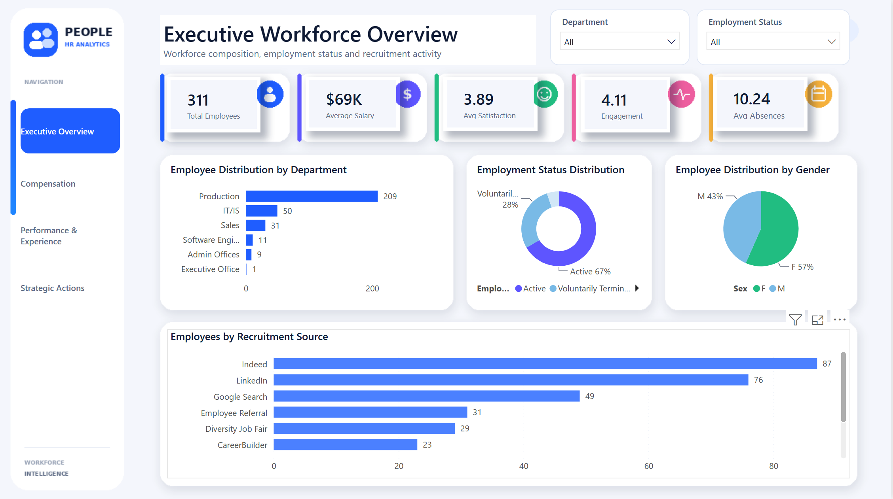
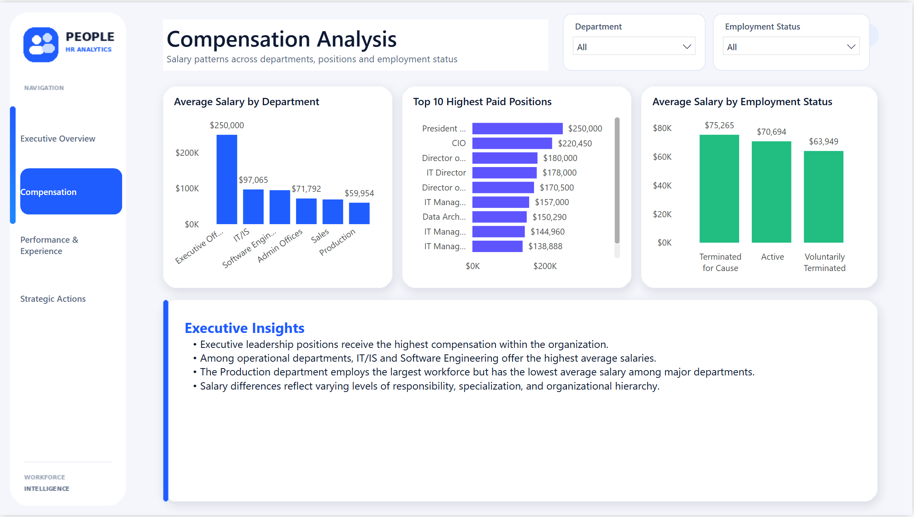
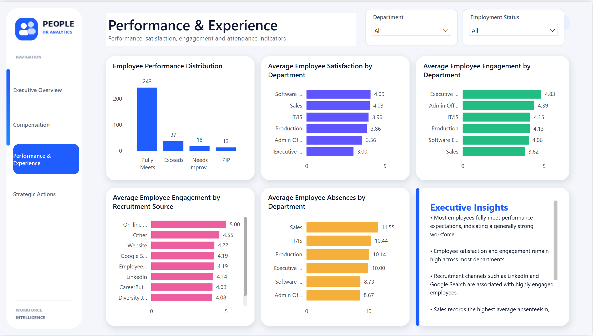
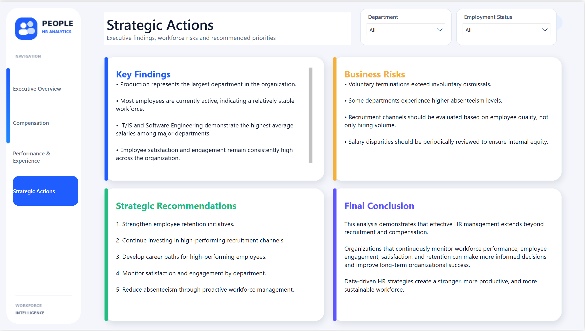

# -HR-Analytics-Workforce-Performance

# HR Analytics | Workforce Performance & Employee Insights

An end-to-end HR Analytics case study focused on understanding workforce composition, compensation patterns, employee performance, engagement, satisfaction, recruitment effectiveness, absenteeism, and employee retention.

Using **Python, SQL, and Power BI**, this project transforms raw employee data into actionable business insights through exploratory analysis, feature engineering, SQL-based business analysis, and an executive dashboard.

---

## Project Overview

The objective of this project is to help HR teams understand workforce trends, identify potential organizational challenges, evaluate recruitment effectiveness, and make data-driven workforce decisions.

### Key Business Questions

- How is the workforce distributed across departments?
- Which departments and positions offer the highest salaries?
- What is the current employee employment status distribution?
- Which recruitment sources generate the highest number of hires?
- Which recruitment sources are associated with higher employee engagement?
- How do employee satisfaction and engagement vary across departments?
- Which departments experience the highest absenteeism?
- What strategic actions can HR leaders take based on the findings?

---

## Dataset Overview

The project uses an employee-level HR dataset from a fictitious organization.

**Key Dataset Attributes:**

| Category | Fields |
|---|---|
| Employee Information | Employee ID, Gender, Race |
| Organizational Structure | Department, Position, Manager |
| Compensation | Salary |
| Employment Details | Employment Status, Date of Hire, Date of Termination, Termination Reason |
| Recruitment | Recruitment Source |
| Employee Performance | Performance Score |
| Employee Experience | Engagement Survey, Employee Satisfaction |
| Attendance | Absences |

---

## Technology Stack

| Category | Technologies |
|---|---|
| Programming Language | Python |
| Data Analysis | Pandas, NumPy |
| Data Visualization | Matplotlib, Power BI |
| Database | MySQL |
| Development Environment | Jupyter Notebook |
| Documentation | GitHub Markdown |

---

## Analytical Workflow

The project follows a structured data analytics process:

1. **Data Understanding:** Explore dataset structure, dimensions, columns, and data types.
2. **Data Quality Assessment:** Identify missing values, duplicates, and data inconsistencies.
3. **Exploratory Data Analysis:** Examine workforce distribution, compensation, recruitment, performance, engagement, and attendance.
4. **Feature Engineering:** Create additional analytical categories and workforce indicators.
5. **Business Analysis:** Use SQL to answer 20 HR-related business questions.
6. **Dashboard Development:** Build an interactive Power BI dashboard.
7. **Executive Reporting:** Translate analytical findings into business insights and strategic recommendations.

---

## Repository Structure

```text
hr-analytics-workforce-performance/
│
├── data/
│   └── HRDataset_v14.csv
│
├── notebook/
│   ├── 01_data_understanding.ipynb
│   ├── 02_data_quality_assessment.ipynb
│   ├── 03_exploratory_data_analysis.ipynb
│   ├── 04_feature_engineering.ipynb
│   └── 05_executive_summary_and_business_recommendations.ipynb
│
├── SQL/
│   └── hr_workforce_business_analysis.sql
│
├── dashboard/
│   └── HR_Analytics_Dashboard.pbix
│
├── images/
│   ├── executive_overview.png
│   ├── compensation_analysis.png
│   ├── performance_experience.png
│   └── executive_recommendations.png
│
├── README.md
├── requirements.txt
└── LICENSE
```

---

## Project Implementation

### 1. Data Understanding

**Notebook:** `01_data_understanding.ipynb`

Examines the dataset structure and identifies the information available for analysis.

- Dataset dimensions
- Column names and data types
- Numerical summaries
- Categorical summaries
- Initial observations

### 2. Data Quality Assessment

**Notebook:** `02_data_quality_assessment.ipynb`

Evaluates the reliability and completeness of the dataset.

- Missing values analysis
- Missing value percentages
- Duplicate record identification
- Data type validation
- Unique value analysis
- Data quality conclusions

**Key Observation:** Missing values in `DateofTermination` are expected because active employees do not have termination dates.

### 3. Exploratory Data Analysis

**Notebook:** `03_exploratory_data_analysis.ipynb`

Conducts detailed analysis to identify workforce patterns and organizational trends.

Areas covered:

- Workforce distribution by department
- Employment status distribution
- Salary analysis by department and position
- Recruitment source effectiveness
- Performance score distribution
- Employee satisfaction analysis
- Employee engagement analysis
- Absenteeism by department
- Descriptive salary and absence statistics

### 4. Feature Engineering

**Notebook:** `04_feature_engineering.ipynb`

Creates additional business-oriented features to support deeper analysis and dashboard development.

| Engineered Feature | Purpose |
|---|---|
| Salary Category | Categorizes employee compensation |
| Satisfaction Category | Groups satisfaction levels |
| Engagement Category | Groups engagement levels |
| Attendance Category | Categorizes attendance patterns |
| High Performer Flag | Identifies high-performing employees |
| Attrition Flag | Identifies employee attrition |

### 5. Executive Summary & Business Recommendations

**Notebook:** `05_executive_summary_and_business_recommendations.ipynb`

Consolidates analytical findings into business-focused insights.

Key areas:

- Workforce structure
- Compensation insights
- Recruitment effectiveness
- Employee performance patterns
- Engagement and satisfaction levels
- Attendance risks
- Strategic HR recommendations

---

## SQL Business Analysis

**SQL File:** `hr_workforce_business_analysis.sql`

Performed SQL-based analysis to answer **20 executive business questions** related to workforce performance and employee experience.

### Analysis Coverage

- Total employee count
- Employee distribution by department
- Employment status distribution
- Gender and race distribution
- Average salary by department
- Highest-paid positions
- Salary statistics
- Performance score distribution
- Satisfaction by department
- Engagement by department
- High performers by department
- Recruitment source analysis
- Absenteeism by department
- Termination reason analysis
- Executive workforce summary

---

## Power BI Dashboard

The Power BI dashboard is organised into four executive-level analytical pages.

### 01. Executive Overview

Provides a consolidated view of the organization's workforce.

**KPIs and Visualizations:**
- Total Employees
- Average Salary
- Average Satisfaction
- Average Engagement
- Average Absences
- Employees by Department
- Employment Status Distribution
- Gender Distribution
- Recruitment Source Distribution

### 02. Compensation Analysis

Evaluates salary distribution and compensation patterns.

**KPIs and Visualizations:**
- Average Salary by Department
- Top 10 Highest-Paid Positions
- Average Salary by Employment Status
- Executive Compensation Insights

### 03. Performance & Experience

Explores employee performance, engagement, satisfaction, and attendance.

**KPIs and Visualizations:**
- Performance Score Distribution
- Satisfaction by Department
- Engagement by Department
- Engagement by Recruitment Source
- Absenteeism by Department
- Executive Insights

### 04. Executive Recommendations

Presents the major analytical findings and translates them into strategic business recommendations.

**Coverage:**
- Key Findings
- Business Risks
- Strategic Recommendations
- Final Conclusion

---

## Dashboard Previews

### Executive Overview


### Compensation Analysis


### Performance & Experience


### Executive Recommendations


---

## Key Business Insights

The analysis identified the following workforce patterns:

1. **Department Distribution:** Production represents the largest department in the organization.
2. **Employment Status:** Most employees are currently active.
3. **Compensation:** IT/IS and Software Engineering have the highest average salaries among major departments.
4. **Executive Compensation:** Executive leadership positions receive the highest compensation overall.
5. **Recruitment Effectiveness:** Indeed and LinkedIn generate the largest number of hires.
6. **Employee Engagement:** LinkedIn, Google Search, and Employee Referral are associated with strong employee engagement.
7. **Employee Experience:** Satisfaction and engagement are generally high across the organization.
8. **Absenteeism:** Sales records the highest average absenteeism.
9. **Employee Turnover:** Voluntary terminations exceed involuntary dismissals.

---

## Strategic HR Recommendations

Based on the analytical findings, the following actions are recommended:

- Strengthen employee retention initiatives to reduce voluntary turnover.
- Continue investing in recruitment channels associated with highly engaged employees.
- Develop career growth opportunities for high-performing employees.
- Monitor employee satisfaction and engagement at the department level.
- Review absenteeism trends and implement proactive workforce management initiatives.
- Periodically evaluate salary distribution to support internal compensation equity.

---

## Skills Demonstrated

- Data Cleaning
- Data Quality Assessment
- Exploratory Data Analysis (EDA)
- Feature Engineering
- Descriptive Statistics
- SQL Business Analysis
- Power BI Dashboard Development
- KPI Development
- HR Analytics
- Executive Data Storytelling
- Business Recommendations

---

## Future Enhancements

Potential improvements to extend the analytical capabilities of this project:

- Develop an employee attrition prediction model using Machine Learning.
- Build an interactive web-based HR dashboard.
- Introduce statistical testing for salary equity analysis.
- Incorporate time-based workforce trend analysis.
- Implement advanced employee segmentation by tenure, department, and performance.

---

## Project Outcome

This case study demonstrates how **Python, SQL, and Power BI** can be combined to analyse workforce data, identify organizational trends, evaluate employee experience, and communicate actionable insights through executive-level reporting.

